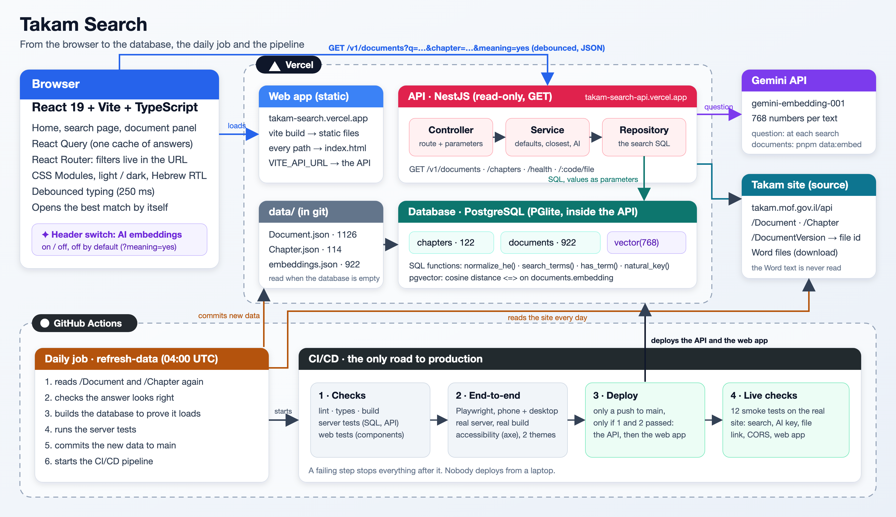

# Takam Search

A better search for the **Takam instructions**: the binding rules of Israel's Accountant General for every government ministry ([takam.mof.gov.il](https://takam.mof.gov.il)).

A React web app and a NestJS API over a PostgreSQL database that we own, in one pnpm monorepo. Everything is TypeScript. An AI "search by meaning" (embeddings in pgvector) can be switched on and off from the header.



*From the browser to the database, the daily job and the pipeline. A Hebrew write-up of the assignment (problem, solution, architecture, tests) is in [docs/overview/takam-search.pdf](docs/overview/takam-search.pdf).*

## The problem

A civil servant with a concrete situation, such as *"what do I do if the budget is exceeded?"*, cannot reliably get to the rule that applies. The search of the site (in its source, `filterByFreeTxt`) is a plain "contains" on the title, the description, the keywords and the number. Observed on the site:

| You type | What the site does |
|---|---|
| `קופת ביטחון`, then `קופות ביטחון` | 2 results, then 4: the singular does not find the plural |
| `התחייבות`, then `התחייבויות` | 11 results, then 5 |
| `מה עושים כשיש חריגה` | 0 results: a question is not a title |
| `מקדמות ללא התחייבות` | 0 results, although the instructions on advances and on payments without commitments exist |
| anything with no result | the address becomes `/document/undefined` and the page stays empty, with no help |

Behind it, more defects: an inverted validity flag, a chapter missing from the filter, a tag filter with no data ([docs/site-audit.md](docs/site-audit.md)). The people affected are the staff of the ministries who must apply these rules; that they lose time or apply a wrong rule is a reasonable hypothesis, not a measurement.

## The solution

**A parallel database with a real search API on top of it.** The objects of the site come from Salesforce (their ids and fields are Salesforce's: `sfid`, `rtn_*__c`). My assessment (not something I measured on Salesforce) is that it is a system of record, not a search backend: its query language is built to read records, not to do ranked, Hebrew-aware or semantic search, and it comes with API limits. The site itself shows the consequence: its API hands the whole list to the browser (75 KB gzipped) and the browser filters it. So the objects are copied into a **read-optimised PostgreSQL database that we own**, and a NestJS API answers with SQL written for this one job.

**A precise SQL search on the fields we have.** The same documents, searched by the server on cleaned columns of the table:

- **Singular and plural are the same word**, quotes inside a word do not matter (`דו"ח` = `דוח`), the little words of a question are ignored (`מה`, `האם`, `כשיש`...).
- **Every word must match; if no document has them all, the closest ones are shown, and the answer says so.** A question is never a dead end.
- **Best match first** (a word in the title or the number counts more than one in the description), then the order of the numbers. On a wide screen the best match opens by itself.
- **Filters on the server too**: chapter, sub-chapter, kind of document, in force or not (computed from the dates, not from the site's inverted flag).
- **Nothing found is a normal answer**, with a valid address and a way to clear the filters.
- **Speed**: one SQL query on indexed, pre-cleaned columns; no list is sent to the browser to be filtered there.

**AI on top, as a switch.** A small ✦ button in the header turns on the **search by meaning** (off by default, `?meaning=yes` in the address). A script (`pnpm data:embed`, run by the daily job for what is new or changed) asks Gemini for an **embedding** of every document (title + description + keywords, 768 numbers) and stores it in a **pgvector** column. When the switch is on, the question is embedded too and the database orders the documents by closeness, mixed with the words (a number or an exact term still wins). *"Can I pay a supplier before I received the goods?"* finds the instructions on advance payments (1.4.2, 1.4.5), which the search by words does not (it answers with cars and hotels). Without a Gemini key the switch answers a clear 503 and the search by words is untouched.

**The next step, if it is needed:** embed the **text of the documents** as well (chunks of the Word files in pgvector) and let the AI write an answer with its sources (RAG). It is a deeper search with its own costs and risks, so it is left out of this POC; today only the metadata of the site's own objects is searched.

## Run it

Prerequisites: Node ≥ 22 and pnpm 11 (`corepack enable`).

```bash
pnpm install        # also builds packages/contracts
pnpm dev            # API on http://localhost:3100, web app on http://localhost:5173
```

Open <http://localhost:5173> (the home page); the search is at `/documents`. The API's own pages: <http://localhost:3100/docs> (Swagger) and <http://localhost:3100/health>.

The first start creates the database (about two seconds) in `apps/server/.pgdata/`. Nothing to install and no secret needed to run it. To try the AI search, put a Gemini key in `apps/server/.env` (git ignores it; `pnpm dev` reads it): `GEMINI_API_KEY=...`. [`.env.example`](.env.example) lists every variable (`PORT`, `CORS_ORIGINS`, `DATABASE_DIR`, `VITE_API_URL`, `GEMINI_API_KEY`, `TAKAM_API_URL`).

| Command | What it does |
|---|---|
| `pnpm dev` | API and web app with reload |
| `pnpm build` | Builds the contracts, the server and the web app |
| `pnpm lint` | oxlint |
| `pnpm typecheck` | `tsc` on the three packages |
| `pnpm test` | Server (unit + end-to-end) and web (unit + component) tests |
| `pnpm test:coverage` | The same tests with the coverage report and its bars |
| `pnpm test:e2e` | Builds both apps and runs the Playwright suite (phone and desktop, axe in both themes) on its own ports |
| `pnpm db:query "SELECT …"` | Runs a SQL query on a fresh copy of the database and prints the rows |
| `pnpm db:reset` | Forgets the database; the next start rebuilds it |
| `pnpm --filter @takam/server data:refresh` | Reads the Takam site again and replaces the two data files |
| `pnpm --filter @takam/server data:embed --all` | Makes the embeddings (needs `GEMINI_API_KEY`): only what is new or changed |

If something already listens on port 3100 or 5173, set `PORT` (and `API_PROXY_TARGET` for the web dev server).

## How it is built

```
Takam site ──(daily job)──▶ data/*.json ──(start)──▶ PostgreSQL + pgvector ──▶ NestJS API ──/v1──▶ React app
 Document, Chapter           in git                    2 tables, SQL functions     controller → service → repository
                                  ▲                                                     │
                       pnpm data:embed ◀── Gemini ◀─────────── question (when the ✦ switch is on)
```

| Part | |
|---|---|
| `apps/server` | NestJS 11, one folder per route (controller → service → repository → database), plus `ai/` (`AiService` and one class per provider). The search is `SEARCH_SQL` in `src/documents/documents.repository.ts`; the cleaning of Hebrew is the SQL functions of `src/database/schema.sql`. See [apps/server/README.md](apps/server/README.md) |
| `apps/web` | React 19, Vite, **TanStack Query as the one cache of the API's answers** (see below), React Router, CSS Modules over design tokens (light and dark), Heebo font, laid out in the order of the official site ([docs/ui.md](docs/ui.md)). Vitest, Testing Library and Playwright |
| `packages/contracts` | The types of the API answers, shared by the two apps |
| `.github/workflows/` | `ci.yml`: checks, end-to-end tests, deploy, checks of the live site. `refresh-data.yml`: the daily reading of the site |

**The web app calls the API through a cache (TanStack Query), the recommended way, not with hand-made `useState` and `useEffect`.** Every answer is cached under its key (the filters of a search, the number of a document): going back to a search or a document already seen shows it at once, with no request. An answer stays fresh for 5 minutes and the chapters for the whole visit; identical requests are merged into one, an old request is cancelled when the person keeps typing (on top of a 250 ms pause), and the previous list stays on screen until the next one arrives (`keepPreviousData`, no flash of an empty page). A failing server is tried twice more, a refusal (4xx) is not; the loading, error and "try again" states come from the same place.

**PostgreSQL itself runs inside the server** ([PGlite](https://pglite.dev), with the pgvector extension): the same SQL as a PostgreSQL server, with nothing to install. A shared server would change the connection, not the queries.

**The rules are part of the architecture**, written in [CLAUDE.md](CLAUDE.md) and enforced by tests and by the pipeline: the layers of the server and their one-way dependencies, the search always in SQL with values as parameters, a read-only API with one JSON error body, the AI only behind `AiService` (tests never call a real AI), the interface text only in `messages.ts`, colors only in `tokens.css` (contrast AA in both themes, tested), the search state in the address, and the docs updated in the same commit as the code.

More: [docs/README.md](docs/README.md) is the map ([architecture](docs/architecture.md), [data](docs/data.md), [API](docs/api.md), [interface](docs/ui.md), [site audit](docs/site-audit.md), [testing](docs/testing.md)).

## Tests and quality

| Level | What | Count |
|---|---|---|
| Server unit | The SQL functions, the loader, the search SQL on the real data in memory, the service, the AI module (fake provider, faked `fetch`), the Takam site client | 141 tests with the end-to-end ones below |
| Server end-to-end | The whole application, one file per route, the AI and the Takam site faked | included above |
| Web unit and component | Pages over a fake API, every component, the API client, the design tokens (contrast AA) | 89 |
| Web end-to-end | Playwright on the builds, phone and desktop, axe accessibility in both themes | 100 |
| Live site | `scripts/smoke-test.mjs`, 12 checks run after every deploy | 12 |

**Coverage, measured (`pnpm test:coverage`), not perfect:** server 99.0 % of statements, 87.1 % of branches, 100 % of functions and lines; web 97.9 % of statements, 93.7 % of branches, 96.7 % of functions, 98.8 % of lines. The pipeline fails if a change brings the coverage under the bars set in `apps/server/jest.config.js` and `apps/web/vite.config.ts`. The end-to-end tests are not counted in these figures. What is not covered is listed by the report (mostly defensive branches).

**Edge cases tested:** an empty answer, a one-word and a question search, `H.7.1.5` (hidden by the site), chapter 10 (missing on the site), singular and plural, quotes, an injection attempt in the words, an unknown document, the AI key missing or the AI failing, the Takam site failing, a wrong file id, CORS read-only, a phone and a desktop screen.

## Deployed (Vercel)

- Web: https://takam-search.vercel.app
- API: https://takam-search-api.vercel.app (try `/health`, `/v1/documents?q=קופות ביטחון`)

Two Vercel projects, one per app. Settings live on Vercel, set with the CLI: the API has `CORS_ORIGINS` (the address of the web app), the web app has `VITE_API_URL` (the address of the API) and a rewrite of every path to `index.html` (`apps/web/vercel.json`).
The database is built in memory on every cold start of the API (about 8 to 10 seconds for the first request, then fast). PGlite's binary files are read in `read-pglite-files.ts` with plain paths so that Vercel includes them.
**Only GitHub deploys**, and only after every check: `.github/workflows/ci.yml` runs the lint, the types, the build and the server and web tests, then the end-to-end tests, then (on `main` only) deploys the API and the web app to Vercel, then runs `scripts/smoke-test.mjs` on the live site. It needs the `VERCEL_TOKEN` secret and the repository variables `VERCEL_ORG_ID`, `VERCEL_API_PROJECT_ID` and `VERCEL_WEB_PROJECT_ID`.

## Limits you should know

- The search reads titles, descriptions, keywords and numbers, **not the text of the instructions**, and the search by words has no notion of meaning (a synonym is not a match). An experiment, "search by meaning" (pgvector + Gemini embeddings of the title, description and keywords of all 922 documents), covers that.
- The Hebrew rules (endings and prefixes) are simple rules, not a dictionary: they are right most of the time and sometimes wrong, in the same way on both sides of the comparison. They are tested on word pairs, not measured on real questions.
- 7 of the 11 instructions that the site does not show in its tree say in their description that they were merged or renumbered, so the site probably hides them on purpose; here they are kept and their description tells where they went. They count as "in force" because the data gives them no end date.
- The data is two committed files, read again from the site every day by a workflow (`pnpm data:refresh`); between two readings it is up to a day old. The interface is Hebrew only.
- The harm of the problem on real users was not measured.

## Engineering questions (part C of the assignment)

### 1. Design decisions: the considerations, the alternatives, what I gave up

**What guided the design.** (a) A person must reliably reach the right instruction, so the search is the product and everything else serves it. (b) The data belongs to the Takam site and lives in Salesforce, which is a system of record, not a search backend: so a **parallel database that we own**, with a search written in SQL for this job. (c) A reader must be able to follow a request in four files, so the server is plain. (d) What is risky (the AI, the Takam site) sits behind one class and a switch, and the rest works without it.

| Decision | Alternative I weighed | Why this one |
|---|---|---|
| A **parallel read database**, copied from the site's objects | Searching in Salesforce itself, or filtering the full list in the browser like the site does | In my assessment Salesforce is not built for Hebrew-aware, ranked or semantic search and has API limits; the browser filter ships the whole list at every visit |
| The search is **one SQL query** on cleaned columns | Elasticsearch / Meilisearch | 922 documents: a second system to run for no gain; the SQL can be read in one file |
| **The same SQL function cleans the stored text and the typed words** | Cleaning in TypeScript for the query only | Both sides always agree |
| **PostgreSQL inside the server (PGlite)** with pgvector | SQLite, or a hosted PostgreSQL | The real SQL and real vectors with nothing to install; moving to a shared server changes the connection, not the queries |
| **AI as a switch**, embeddings of the metadata, hybrid with the words | Always on, or RAG over the full text from the start | A synonym finds its instruction, but the exact words and the number keep winning; the switch is off by default and safe to turn off |
| **Only the metadata** of the site's objects | Indexing the Word files | It is what the site already knows; reading the documents is a larger project (parsing, size, freshness, wrong answers in a legal context) |
| **"In force" computed from the dates** | Trusting `isvalid` | The flag is inverted in the site's API ([docs/site-audit.md](docs/site-audit.md)) |
| Every word must match, otherwise the closest documents, said so | Always "any word", or an empty answer | A question is never a dead end |
| One pipeline, GitHub only deploys | Deploying from a laptop | Nothing reaches production without every check |

**What I gave up in the POC:** the text of the documents and an answer written by the AI (RAG); a persistent shared database; pagination in the web app (it asks for up to 1000 results, the API has `limit` and `offset`); authentication (nothing is private); a Hebrew dictionary (the endings and prefixes are hand-written rules); tags (the site's are empty); an English interface.

### 2. Quality and maintainability: a significant limit

**The database lives inside the API process and is rebuilt from committed files at every start.** Consequences:
- the first request after a quiet period waits for the build (about 3 seconds locally, 8 to 10 on Vercel);
- new data reaches the live API only through a redeploy (the daily pipeline does it, but it is a deploy, not a write);
- each instance has its own copy, so nothing can ever be written;
- `embeddings.json` (9 MB of numbers) is committed, so the git history grows with every change;
- the Hebrew rules and the 0.06 closeness window of the AI search are hand-tuned on a small sample, not measured on real questions.

**The change I would make:** a managed PostgreSQL with pgvector (Neon, Supabase...) read through a `DATABASE_URL`; the daily job becomes the only writer (it already reads, checks and embeds), and the vectors live in the database instead of git. Only `DatabaseService` changes, because every query already goes through `query()`. Then a set of real questions with the expected instruction to measure the search, instead of word pairs.

### 3. Development and deployment: another developer deploying to a new environment

**What would get in their way today:** the two Vercel projects, their environment variables (`CORS_ORIGINS`, `VITE_API_URL`, `GEMINI_API_KEY`) and the GitHub secret and variables were created by hand; the API must be built inside `apps/server` and deployed from the root because the build output has root-relative paths; PGlite's binary files must be read with literal paths for Vercel to include them (`read-pglite-files.ts`); and it is tied to Vercel.

**What is already in place:** `pnpm install && pnpm dev` runs everything with no secret; [`.env.example`](.env.example) lists every variable; the pipeline `ci.yml` checks, deploys and checks the live site, and the daily job feeds it; nothing deploys from a laptop.

**What I would change:** describe the infrastructure as code (the Vercel projects and their variables in the repository, or a Dockerfile and a compose file so that any host works); a single `bootstrap` script that creates a new environment and prints what is missing; versions pinned (Node, pnpm, `vercel`).

**How I check it works after a deploy:** the last job of the pipeline runs `scripts/smoke-test.mjs` on the live site (12 checks: the API is up with its data loaded, the search by words and by meaning, `H.7.1.5`, a question, an empty answer, the attached messages, the file link, a 404, CORS from the web app, the web app and a deep link). `/health` also tells how many documents and chapters are loaded.

### 4. Diagnosis and fault handling: a significant failure

**Scenario: the Takam site changes the shape of its data, or is down, when the daily job reads it.**
- *How it shows:* without protection, the database would load documents with no number, searches by number would find nothing, and the API would still look healthy.
- *How it is found and handled today:* the job asks the site with `checkSiteData` first (the answer must be a list, with at least 900 documents that have a number and 100 chapters), then builds the database from the new files to prove they load, then runs the server tests. If anything is wrong it stops and **keeps the old files**, and GitHub shows a failed run. `/health` reports the number of documents and chapters, and the smoke tests fail the pipeline if the live data is not loaded.
- *What I would change:* tell someone (a message, not just a red run); put the date of the last successful reading in `/health`; keep the previous files as a dated copy.

**Scenario: Gemini fails or its quota is spent.** The search by meaning answers a clear 503 (the provider's message is not shown) and is logged by `AiService`; the search by words is not touched; the provider retries the passing errors (429, 5xx) and the embedding script waits when told to slow down. I would add a metric on the rate of 503s, and a daily cap.

**Observed during this work:** right after a deploy the first requests of a cold instance failed once with a platform error, and then everything answered. The smoke job asks the API again for up to 90 seconds for that reason; a warm instance or a persistent database would remove it.
